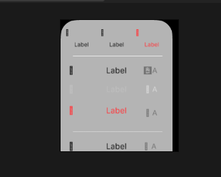

# fyy apple style — feedback and source references

## Sizing requirement

Import each complete source element from its original `.fig` node. Do not add per-element size ceilings, shrink-to-fit behavior, or crops. The importer preserves the full component's authored dimensions and does not auto-fit it to the target composition. If the target composition is smaller, enlarge the composition instead of resizing imported content. Image placement/scale inside a component continues to follow the original Figma node bounds so its source layout is reproduced.

Path geometry must remain centered at the shape anchor to prevent the previously reported offset/cropping problem. Use only original `.fig` files as importer sources; do not replace missing or unsupported content with hand-built art, SVG exports, or thumbnails. Clearly disclose any source effects/fonts that cannot be preserved faithfully/editably.

## User-reported white-rectangle import issue

The Activity View report/screenshot shows a single white rounded rectangle even though the panel reports 102 source records. The embedded payload contains 102 flattened records (23 shapes, 56 text nodes, and 23 images), so the white card is not the complete component. The importer now preserves authored visibility at the insertion frame and explicitly restores the source paint order; failures remove partial comps/layers and report an error rather than leaving a white-box-only precomp. The latest host tests exposed a shared PUA-glyph failure across Search, Quick Action, Menu, Find, and related files, plus a Thumbnail image failure in Activity View - iPad. Glyph mask mode now has a numeric AE fallback when the host enum is null; image temp files are length-checked and import results validated. These are targeted code corrections, not yet verified by a new host render. The payload is flattened and does not preserve editable nested Figma group relationships.

## User-reported glyph issue

The screenshot shows small, fragmented or box-like marks in icon/symbol positions among otherwise legible labels. The source `.fig` stores many icons as Private Use Area text glyphs; the earlier importer created ordinary AE text with a regular SF Pro font, so the host could show missing-glyph boxes instead of the Figma artwork. The importer now embeds the actual glyph-outline command blobs from the `.fig` source for all 104 PUA symbol text nodes in the 34-item catalog (21 codepoint/style outlines), then creates editable AE mask paths from those outlines. It no longer relies on a host SF Symbols font or replaces the icon with a hand-built asset.

A follow-up review found why the first vector attempt could produce blank icons: glyph vertices had been centered like AE shape-layer paths, but AE mask vertices use the solid's top-left source coordinates. The importer now builds mask paths in mask/source coordinates (without the shape-layer center offset), sizes each mask solid to the full glyph outline, and uses numeric AE mask mode constants if the host exposes a null `MaskMode` enum. The user reported the same null/undefined error for many PUA glyphs; re-test all of those nodes after the fallback. If a glyph remains wrong, compare its `glyphKey`/source node outline—not a substitute icon—and preserve the complete source bounds.

## Supplied PSD/AI icon templates reviewed

Drive folder: [iOS 27 Icon Templates — Photoshop/Illustrator](https://drive.google.com/drive/folders/1f-7ci_79Tbx_EPz7cS5E284oqwlaC-ha?usp=drive_link).

- `App Icon Template.psd`: 1024 × 1024 RGB document with background, export groups/layers (PNG and SVG), grid smart object, and app-icon shape. Its visible composite is a construction grid with overlapping circles, not a finished icon.
- `App Icon Template.ai`: a PDF-compatible 1024 × 1024 page; its preview likewise shows the icon construction template.

These were inspected as references, not used as importer sources or substitutes. The importer remains `.fig`-only.

## Figma symbolic/emoji references

The Figma connector is unavailable in this session, so this is a bounded audit of locally available original `.fig` archives, not a live/exhaustive search of the user's Figma workspace.

- `Activity View.fig` and `Alert.fig` include Figma `SYMBOL` nodes and SF-system-style glyphs encoded as Private Use Area text. `Activity View.fig` includes a `_System Icons` section with named icons including Airdrop, Weather, Wallet, Photos, Music, Maps, and Calendar.
- `Button - Liquid Glass - Symbol.fig` is a symbol source whose thumbnail shows a blue circular button with a white checkmark.
- These archives confirm symbol references. No standalone emoji asset/reference was confirmed in the inspected files; this does not establish that none exists in the full Figma workspace. Private Use Area glyphs also depend on compatible fonts being available and mapped in the host.

## Editable text mapping update

The embedded catalog contains 310 text nodes across SF Pro Regular, Medium, Semibold, and Bold. The importer maps all four source weights to their corresponding SF Pro PostScript names and disables faux-bold. Text alignment now positions the point-text origin at the source bounds' left, center, or right anchor for every node, rather than treating nodes named `Label` as centered regardless of source alignment. For any child whose authored bounds extend outside a component frame, the generated precomp canvas expands to include it while the nominal source frame stays centered at 100% scale. Exact font availability, text baselines, and overflow rendering still need host verification.

## Follow-up acceptance checks

1. Import all source nodes at their complete authored bounds, with no auto-fit of the component and no added per-element ceilings/crops.
2. Confirm path points are centered; compare element bounds and placements with the `.fig` source.
3. Compare icon/symbol glyphs with original Figma nodes and fonts; do not silently replace missing glyphs.
4. Keep supported vectors and text editable; report unsupported effects and font limitations.
5. Verify visually in EffectCraft/After Effects. Existing parser/mock tests do not prove host-runtime compatibility.
